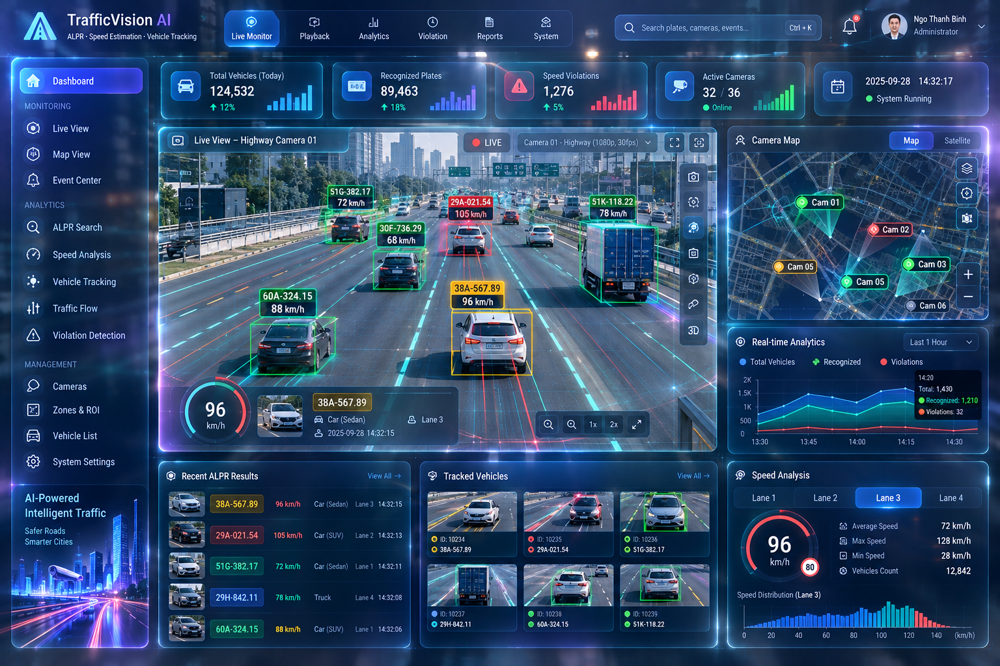

# ALPR — High-performance Chinese licence plate recognition
 

Two parts:

| Part | Folder | Tech |
|---|---|---|
| **Training** (few data) | [`training/`](training/README.md) | Python 3.13 (Anaconda), PyTorch, Ultralytics YOLO26-pose, ONNX |
| **Inference app "ALPR Studio"** | [`inference/`](inference/README.md) | Visual Studio 2019, Qt 5.15, OpenCV 4.14, ONNX Runtime 1.30 |

```
ALPR/
├─ packages/            every dependency, downloaded (offline install / build)
│  ├─ python/           wheels for the training env          (download_python_packages.bat)
│  ├─ qt/ opencv/ onnxruntime/ cmake/ redist/                 (download_cpp_packages.bat)
│  └─ weights/          COCO-pretrained yolo26n-pose.pt / yolo11n-pose.pt
├─ datasets/raw/        CCPD 2019 (blue) + CCPD 2020 (green)
├─ datasets/test/       held-out test clip + image folder for trying the app
├─ training/            00…07 scripts (07 = one-command fine-tuning), infer.py (test models), alpr/,
│                       README (detailed process), RESULTS.md, EXTENDING.md (other plates / languages)
├─ models/              trained plate_det.onnx + plate_rec.onnx + alpr_models.json
├─ inference/           ALPR Studio source: ALPRStudio.sln (VS2019), ALPRStudio.pro (qmake), CMakeLists.txt
└─ dist/ALPRStudio/     ready-to-run build (VS2019 v142 toolset) + vc_redist.x64.exe
```

## Try it now
`dist\ALPRStudio\ALPRStudio.exe` → create the admin account → click a tile → choose
`datasets\test\ccpd_test_clip.mp4` (video) or `datasets\test\images` (image folder) → ▶.

## Results (CPU only, few data)
| | Blue plates | Green plates |
|---|---|---|
| Detection recall (held-out) | 100 % | 98.9 % |
| Exact plate read, end-to-end | 93.9 % | 85.5 % |
| C++ engine speed, 1 channel | 29 ms/frame (34 fps) | |

Detector trained on 800 images; recogniser pre-trained on 40 000 synthetic plates, then fine-tuned on real crops.
Full numbers and the strict 800-image baseline are in [`training/RESULTS.md`](training/RESULTS.md).
Fine-tuning on 340 labelled "site" photos with `07_finetune.py` raised green plates from 84.5 % to 90.6 % on 1 000
unseen images (RESULTS.md section 4).

## Rebuild everything
```bat
REM 1. training (Anaconda Prompt)
cd training
setup_env.bat
conda activate alpr
run_all.bat                 & REM or: run_all.bat 0   (NVIDIA GPU)

REM 2. test the trained models in Python
python infer.py --source ..\datasets\test\ccpd_test_clip.mp4 --show

REM 3. app (VS2019 installed): open inference\ALPRStudio.sln, Release|x64, Build, F5
cd ..\inference
make_dist.bat               & REM ready-to-ship folder in ..\dist\ALPRStudio
```

Pipeline: ROI crop → YOLO26n-pose (plate box + 4 corners) → perspective rectification (+ two-row merge)
→ PlateNet CTC recogniser (characters + colour) → IoU tracker with voting and cooldown → CSV / JSON / SQLite.
